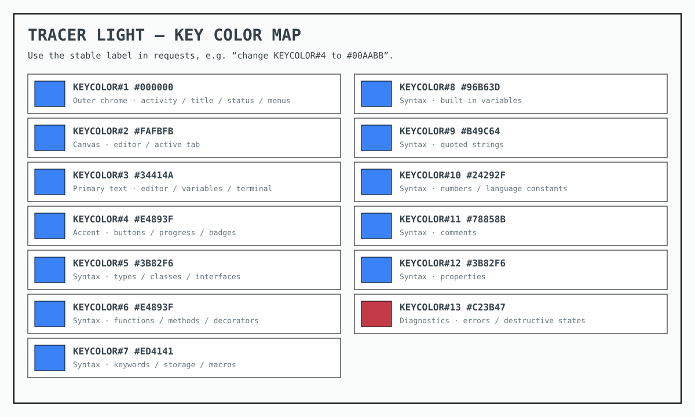
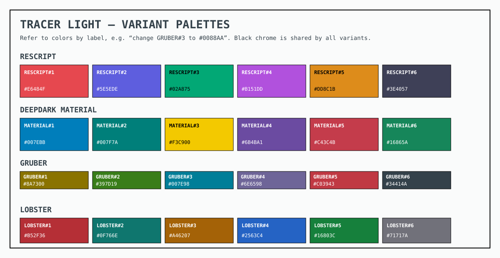

# Tracer Theme

A dependency-free VS Code color-theme family, ready for live editing. **Tracer Light** is the primary theme, with ReScript, Deepdark Material, Gruber, and Lobster-inspired light variants. Every variant shares pure-black activity bars, title bars, status bars, and menus. Light variants use light content surfaces, a subtle dark activity-bar outline, and pale gray sidebar section dividers. Other pane borders remain transparent. Dark variants use Claude Dark (pnyro) warm dividers (`#2B2621`) and input borders (`#3A342A`), with its subtler widget and editor-group borders. Focus outlines and the current-line border remain transparent. Each variant uses its accent for the remote button, selected activity icon and indicator, and active editor tab’s top edge. Tracer Light keeps its Explorer, panels, editor, and controls light with dark text; outer chrome stays black.

## Preview while editing

1. Open this folder in VS Code.
2. Press `F5` and choose **Preview Tracer Light** if prompted.
3. A second Extension Development Host window opens on the `preview` folder with **Tracer Light** selected.
4. Keep `preview/theme-preview.ts` open in that window.
5. Edit and save `themes/tracer-light-color-theme.json` in the original window. The preview updates live.

If the theme is not selected automatically, run **Preferences: Color Theme** in the Development Host and choose **Tracer Light**.

### Switch between variants

The single **Preview Tracer Light** `F5` configuration loads every contributed theme. In the Development Host, run **Preferences: Color Theme** (`Ctrl+K Ctrl+T`) and switch among:

- **Tracer Light**
- **Tracer Light — ReScript**
- **Tracer Light — Deepdark Material**
- **Tracer Light — Gruber**
- **Tracer Light — Lobster**
- **Tracer Dark**
- **Tracer Dark — Pale**
- **Tracer Dark — Lobster**

The light variants inherit the core Tracer Light layout and black chrome, then replace buttons, interaction accents, selections, brackets, diagnostics, Git colors, terminal colors, and syntax colors.

Lobster adapts the installed ChatGPT desktop app’s dark-only Lobster palette to Tracer Light: coral keywords, teal strings, amber constants, blue types, and green functions. Syntax colors are darkened for contrast on the light editor; black chrome is inherited from the base theme.

**Tracer Dark — Lobster** inherits Tracer Dark’s surfaces and layout, with the original Lobster coral, teal, amber, blue, and green syntax colors. Coral accents carry through selections, buttons, and badges; chrome stays pure black, borders use Claude Dark’s warm neutrals, and focus outlines stay transparent. Semantic highlighting uses the same Lobster palette.

**Tracer Light** and **Tracer Dark** share orange interaction accents, warm selections, and the same syntax accent colors, with dark neutral numbers, variables, and delimiters in Light replacing Dark’s white and near-white text. Readonly variables use the orange accent blended at 75% over each editor background, keeping them softer than function names. Light retains its pale editor and dark default editor text; shared accent colors retain Dark’s saturation on the light canvas. Both retain black outer chrome. The light variants inherit Tracer Light’s light sidebar and controls, activity-bar outline, sidebar section dividers, and warm tinted active activity items on the black activity bar. Keeping content surfaces light also keeps extension views such as GitLens compatible with the light editor text palette. **Tracer Dark — Pale** preserves the original pastel dark palette. All dark variants retain GitHub Sharp Dark comma and semicolon colors.

## Useful theme-development commands

- **Developer: Inspect Editor Tokens and Scopes** shows the TextMate scopes and semantic tokens under the cursor.
- **Developer: Generate Color Theme From Current Settings** can capture an existing customized theme as a starting point.
- Reload the Development Host only after changing `package.json`; ordinary theme JSON changes update without a reload.

## Project layout

```text
themes/tracer-light-color-theme.json Primary theme colors and token rules
themes/tracer-light-rescript-color-theme.json ReScript-inspired variant
themes/tracer-light-deepdark-material-color-theme.json Material-inspired variant
themes/tracer-light-gruber-color-theme.json Gruber-inspired variant
themes/tracer-light-lobster-color-theme.json Lobster-inspired variant
themes/tracer-dark-color-theme.json  Primary dark counterpart to Tracer Light
themes/tracer-dark-pale-color-theme.json Original pastel dark palette
themes/tracer-dark-lobster-color-theme.json Lobster-inspired dark variant
docs/theme-palette.svg              Numbered visual palette reference
.vscode/launch.json                  F5 Development Host configuration
preview/                             Sample workspace opened by F5
package.json                         VS Code extension manifest
```

## Palette references

The numbered swatches in `docs/theme-palette.svg` are stable editing references. For example, “change `KEYCOLOR#4` to `#00aabb`” means changing the main accent everywhere it is used and updating the palette image to match.



Variant colors have their own stable labels such as `RESCRIPT#1`, `MATERIAL#1`, `GRUBER#1`, and `LOBSTER#1`.



## Package later

When the theme is ready to share, install the VS Code Extension Manager and run:

```sh
npx @vscode/vsce package
```

## Fresh Editor

The repository also provides **tracer-light** and **tracer-dark** for Fresh's
release builds. Both keep menus and the status bar black, with orange accents
and the corresponding Tracer editor palette. Fresh has fewer syntax categories
than VS Code, so per-scope rules and the readonly-variable modifier are mapped
to its available categories.

Both themes use Fresh's separate Explorer colors so ordinary folder names
follow the sidebar palette independently of code keywords. They also set
colors for the gutter separator, current line number, and the newer number,
property, and attribute syntax categories. Older Fresh builds may fall back
to their original colors for fields they do not recognize.

### Install from GitHub

1. In Fresh, open the command palette and choose **Package: Install from URL**.
2. Enter `https://github.com/mommysgoodpuppy/tracer-theme`.
3. Run **Select Theme** and choose **tracer-light** or **tracer-dark**.

The root `package.json` declares a Fresh theme package and lists only the Fresh
JSON files, so the VS Code themes are not loaded by Fresh. No custom Fresh build
is required. These instructions apply once the Fresh files and manifest have
been pushed to GitHub.

For a local preview before publishing, use **Package: Install from URL** with
`C:\Git\tracer-theme` instead. You can also copy `fresh/tracer-light.json` and
`fresh/tracer-dark.json` into your Fresh configuration's `themes` directory.
