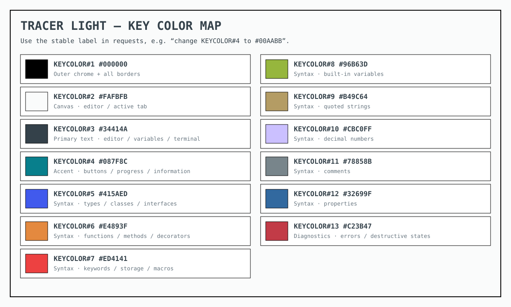
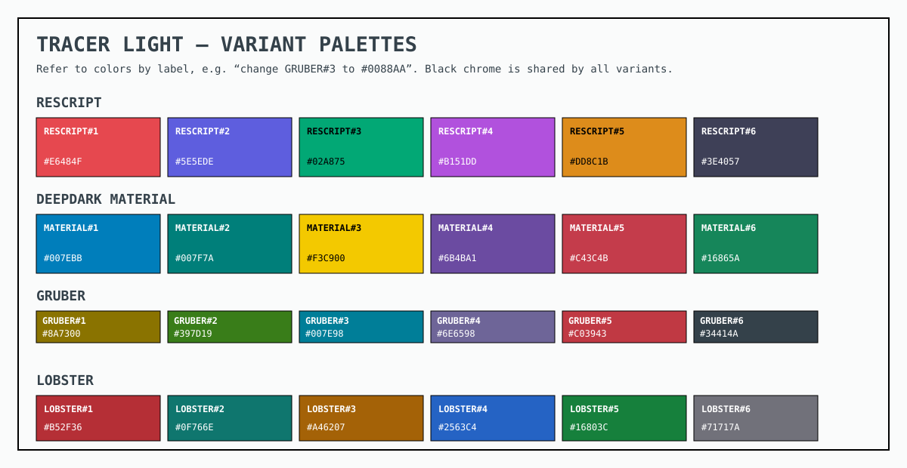

# Tracer Theme

A dependency-free VS Code color-theme family, ready for live editing. **Tracer Light** is the primary theme, with ReScript, Deepdark Material, Gruber, and Lobster-inspired light variants. Every variant shares pure-black activity bars, title bars, status bars, and menus. Light variants use transparent borders. Dark variants use Claude Dark (pnyro) warm dividers (`#2B2621`) and input borders (`#3A342A`), with its subtler widget and editor-group borders. Focus outlines and the current-line border remain transparent. Each variant uses its accent for the remote button, selected activity icon and indicator, and active editor tab’s top edge. Editor and sidebar surfaces retain their light or dark palette.

## Preview while editing

1. Open this folder in VS Code.
2. Press `F5` and choose **Preview Tracer Light** if prompted.
3. A second Extension Development Host window opens on the `preview` folder with **Tracer Light** selected.
4. Keep `preview/theme-preview.ts` open in that window.
5. Edit and save `themes/tracer-light-color-theme.json` in the original window. The preview updates live.

If the theme is not selected automatically, run **Preferences: Color Theme** in the Development Host and choose **Tracer Light**.

### Switch between variants

The single **Preview Tracer Light** `F5` configuration loads every contributed theme. In the Development Host, run **Preferences: Color Theme** (`Ctrl+K Ctrl+T`) and switch among:

- **Tracer Light**
- **Tracer Light — ReScript**
- **Tracer Light — Deepdark Material**
- **Tracer Light — Gruber**
- **Tracer Light — Lobster**
- **Tracer Dark**
- **Tracer Dark — Lobster**

The light variants inherit the core Tracer Light layout and black chrome, then replace buttons, interaction accents, selections, brackets, diagnostics, Git colors, terminal colors, and syntax colors.

Lobster adapts the installed ChatGPT desktop app’s dark-only Lobster palette to Tracer Light: coral keywords, teal strings, amber constants, blue types, and green functions. Syntax colors are darkened for contrast on the light editor; black chrome is inherited from the base theme.

**Tracer Dark — Lobster** inherits Tracer Dark’s surfaces and layout, with the original Lobster coral, teal, amber, blue, and green syntax colors. Coral accents carry through selections, buttons, and badges; chrome stays pure black, borders use Claude Dark’s warm neutrals, and focus outlines stay transparent. Semantic highlighting uses the same Lobster palette.

## Useful theme-development commands

- **Developer: Inspect Editor Tokens and Scopes** shows the TextMate scopes and semantic tokens under the cursor.
- **Developer: Generate Color Theme From Current Settings** can capture an existing customized theme as a starting point.
- Reload the Development Host only after changing `package.json`; ordinary theme JSON changes update without a reload.

## Project layout

```text
themes/tracer-light-color-theme.json Primary theme colors and token rules
themes/tracer-light-rescript-color-theme.json ReScript-inspired variant
themes/tracer-light-deepdark-material-color-theme.json Material-inspired variant
themes/tracer-light-gruber-color-theme.json Gruber-inspired variant
themes/tracer-light-lobster-color-theme.json Lobster-inspired variant
themes/tracer-dark-color-theme.json  Secondary dark variant
themes/tracer-dark-lobster-color-theme.json Lobster-inspired dark variant
docs/theme-palette.svg              Numbered visual palette reference
.vscode/launch.json                  F5 Development Host configuration
preview/                             Sample workspace opened by F5
package.json                         VS Code extension manifest
```

## Palette references

The numbered swatches in `docs/theme-palette.svg` are stable editing references. For example, “change `KEYCOLOR#4` to `#00aabb`” means changing the main accent everywhere it is used and updating the palette image to match.



Variant colors have their own stable labels such as `RESCRIPT#1`, `MATERIAL#1`, `GRUBER#1`, and `LOBSTER#1`.



## Package later

When the theme is ready to share, install the VS Code Extension Manager and run:

```sh
npx @vscode/vsce package
```
