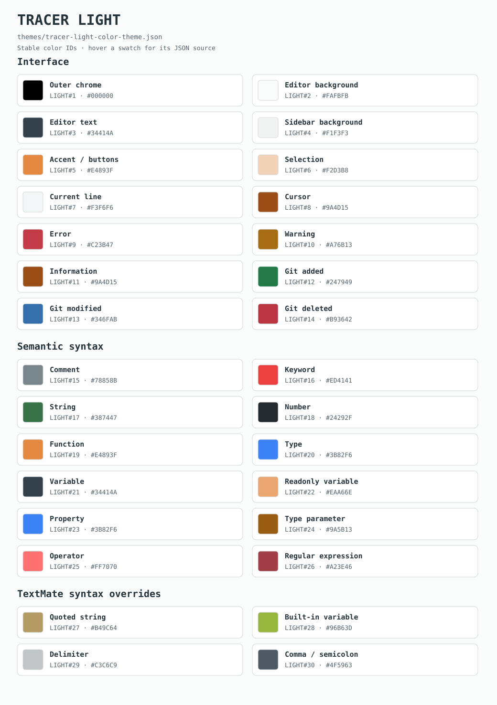
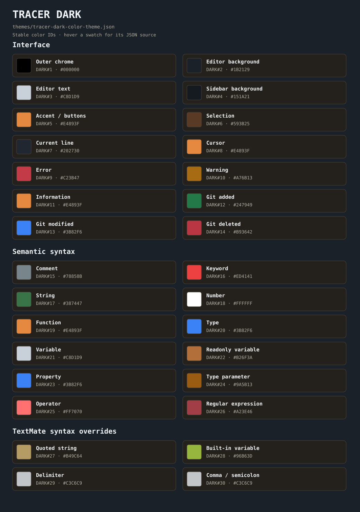

# Tracer Theme

Orange and rust accents, black outer chrome, and a choice of **Tracer Light** or
**Tracer Dark**. Includes themes for VS Code, Fresh Editor, and Zed.

## VS Code

Open this repository in VS Code and press `F5` to launch the preview workspace.
Use **Preferences: Color Theme** (`Ctrl+K Ctrl+T`) to choose Tracer Light or
Tracer Dark. Edit the corresponding JSON in `themes/`; saved changes update live.
Reload the preview after changing `package.json`.

To build an installable extension:

```sh
npx @vscode/vsce package
```

## Fresh Editor

Run **Package: Install from URL** and enter
`https://github.com/mommysgoodpuppy/tracer-theme`, then use **Select Theme** to
choose `tracer-light` or `tracer-dark`. The theme files are in `fresh/`.

Enable **Nerd Font Icons** in Fresh and select a Nerd Font in your terminal.
Tracer Light uses outline folders and a fallback file icon, with dark slate
icons for contrast on light backgrounds; recognized file types retain their
distinctive glyphs. This requires a Fresh version with theme `file_icons` support.

## Zed

Copy `zed/themes/tracer.json` into your Zed themes directory and restart Zed.

- Windows uses `%APPDATA%\Zed\themes\`.
- macOS and Linux use `~/.config/zed/themes/`.

Run `theme selector: toggle` and choose **Tracer Light** or **Tracer Dark**.
You can also run `zed: install dev extension` and select this repository's
`zed/` folder. See the [Zed theme documentation](https://zed.dev/docs/themes).

The Zed themes map the current VS Code UI, terminal, and syntax palettes to
Zed's theme categories. After changing the source themes, regenerate them with
`node scripts/generate-zed.mjs`.

## Palette references

These show the current VS Code interface and syntax colors. Use stable IDs such
as `LIGHT#5` or `DARK#5` when referring to a swatch. Semantic syntax and TextMate
overrides are shown separately; the language and highlighting mode determine
which applies. Hover a swatch in the SVG for its JSON source.

| Light | Dark |
| --- | --- |
| [](docs/tracer-light-palette.svg) | [](docs/tracer-dark-palette.svg) |

After editing a theme, regenerate both references from the theme JSON:

```sh
node scripts/generate-palettes.mjs
```

## Archived experiments

ReScript, Deepdark Material, Gruber, Pale, and Lobster variants, the old palette
references, and the preserved Lobster sources live on
[`archive/experiments`](https://github.com/mommysgoodpuppy/tracer-theme/tree/archive/experiments).
